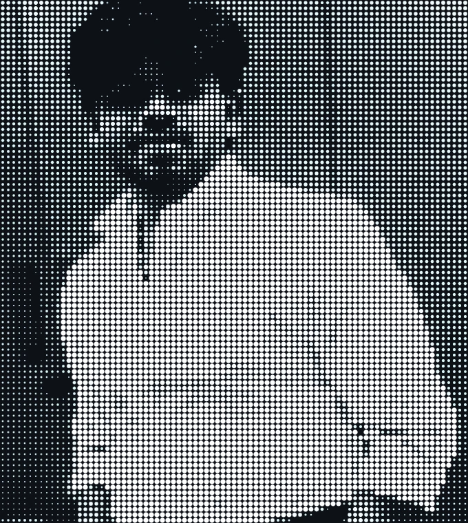

# Marugani Reddi Sekhar

**Full-Stack Developer · AI/ML Builder · Computer Vision Enthusiast · IoT Innovator**

  
  
  
  

> **Build for people. Ship working software. Improve every iteration.**

---

## 👋 About Me

<table>
<tr>
<td width="62%" valign="top">

I am **Marugani Reddi Sekhar**, a software developer and technology builder focused on turning practical ideas into useful products. I work across the full product journey—from system design and development to deployment and continuous improvement.

- 🚀 Full-stack development with **Next.js, TypeScript, Python, FastAPI, Java, and Spring Boot**
- 🤖 AI/ML research and applications in **NLP, computer vision, explainable AI, and intelligent agents**
- 🔌 Connected systems using **IoT, sensors, Arduino, Raspberry Pi, and embedded C++**
- 🧠 Building for **healthcare, accessibility, education, mobility, productivity, and sustainability**
- 📚 Published researcher in **avatar-based fashion fitting** ([Springer](https://link.springer.com/chapter/10.1007/978-3-032-22914-4_2)) and **speech emotion recognition** ([IEEE Xplore](https://ieeexplore.ieee.org/document/11466131))

 

  
  
  

</td>
<td width="38%" align="center" valign="middle">

 
<code>[SYS_ID: MRS-2026 // ONLINE]</code>

</td>
</tr>
</table>

---

## 📚 Publications

<table>
  <tr>
    <td width="50%" valign="top">
      <b>📄 Speech Emotion Recognition Using Hybrid CNN-BiLSTM with Attention</b> 
      <i>IEEE IATMSI 2026</i> — Deep learning architecture combining spatial spectrogram features with temporal bidirectional sequence modeling and attention mechanisms.  
      
    </td>
    <td width="50%" valign="top">
      <b>📄 Personalized Avatar-Based Fitting for Online Fashion</b> 
      <i>IEEE SCIS 2025 / Springer LNCS</i> — 3D digital-twin virtual try-on pipeline designed to improve sizing accuracy and reduce e-commerce return rates.  
      
    </td>
  </tr>
</table>

---

## ⭐ Featured Projects

<table>
  <tr>
    <td width="50%" valign="top">
      <h3>01. <a href="https://github.com/Reddisekharyadav/Allo-reservations-inventory">Allo Reservations Inventory ↗</a></h3>
      
Prevents overselling under high concurrency with atomic holds, PostgreSQL row-level locking, and automated expiry release.

      

        
        
        
        
      

    </td>
    <td width="50%" valign="top">
      <h3>02. <a href="https://github.com/Reddisekharyadav/Rural-Healthcare-Multilingual-Chatbot-Platform">Rural Healthcare Platform ↗</a></h3>
      
Multilingual voice/text chatbot, health analytics, and ML disease prediction designed for accessible rural healthcare triage.

      

        
        
        
      

    </td>
  </tr>
  <tr>
    <td width="50%" valign="top">
      <h3>03. <a href="https://github.com/Reddisekharyadav/AI-powered-smart-glasses">AI Smart Glasses ↗</a></h3>
      
Hands-free real-time scene understanding and audio description pipeline for visually impaired users over BLE.

      

        
        
        
        
      

    </td>
    <td width="50%" valign="top">
      <h3>04. <a href="https://github.com/Reddisekharyadav/Enhanced-Speech-Emotion-Recognition-SER-System">Speech Emotion Recognition ↗</a></h3>
      
Real-time and file-based vocal emotion classification with hybrid deep learning. Published at IEEE IATMSI 2026.

      

        
        
        
      

    </td>
  </tr>
  <tr>
    <td width="50%" valign="top">
      <h3>05. <a href="https://github.com/Reddisekharyadav/company-dairy">WorkSense AI ↗</a></h3>
      
Privacy-first local developer activity tracking, automated session logging, and executive report generation.

      

        
        
        
      

    </td>
    <td width="50%" valign="top">
      <h3>06. <a href="https://github.com/Reddisekharyadav/LifeVault-AI-Your-Life.-Your-Memories.-Forever-">LifeVault AI ↗</a></h3>
      
Privacy-first AI memory and life-insight platform with multimodal capture and mood analytics.

      

        
        
        
      

    </td>
  </tr>
  <tr>
    <td width="50%" valign="top">
      <h3>07. <a href="https://github.com/Reddisekharyadav/Eco-Loop-Building-Agents-Autonomous-Smart-Building-Control">Eco-Loop Building Control ↗</a></h3>
      
Multi-agent autonomous energy optimization and environmental control for smart buildings.

      

        
        
        
      

    </td>
    <td width="50%" valign="top">
      <h3>08. <a href="https://github.com/Reddisekharyadav/Github-repo-intelligence-doc-generator">GitHub Repo Intelligence ↗</a></h3>
      
AI-powered repository architecture analysis and automated technical documentation generator.

      

        
        
      

    </td>
  </tr>
</table>

| Project | Purpose | Technologies |
|---|---|---|
| [Allo Reservations Inventory](https://github.com/Reddisekharyadav/Allo-reservations-inventory) | Prevents overselling with reservations, row locking, and auto-release | Next.js, Prisma, PostgreSQL |
| [Rural Healthcare Platform](https://github.com/Reddisekharyadav/Rural-Healthcare-Multilingual-Chatbot-Platform) | Multilingual chatbot, analytics, and disease prediction for rural healthcare | Python, NLP, ML |
| [AI Smart Glasses](https://github.com/Reddisekharyadav/AI-powered-smart-glasses) | Hands-free scene understanding for visually impaired users | React Native, BLE, FastAPI, CV |
| [Speech Emotion Recognition](https://github.com/Reddisekharyadav/Enhanced-Speech-Emotion-Recognition-SER-System) | Real-time and file-based emotion analysis | Python, CNN/BiLSTM, Attention |
| [WorkSense AI](https://github.com/Reddisekharyadav/company-dairy) | Local developer activity tracking and report generation | Python, FastAPI, SQLite |
| [LifeVault AI](https://github.com/Reddisekharyadav/LifeVault-AI-Your-Life.-Your-Memories.-Forever-) | Privacy-first AI memory and life-insight platform | Kotlin, AI, Mobile |
| [Eco-Loop Building Control](https://github.com/Reddisekharyadav/Eco-Loop-Building-Agents-Autonomous-Smart-Building-Control) | Autonomous energy optimization for smart buildings | Python, Agents, IoT |
| [GitHub Repo Intelligence](https://github.com/Reddisekharyadav/Github-repo-intelligence-doc-generator) | AI-powered architecture analysis and documentation | Python, Hugging Face, AI |

---

## 🧩 All Projects by Category

### 🌐 Full-Stack, Web & Product

- [Meeseva Services](https://github.com/Reddisekharyadav/meesevaservices-Fullstack-Application) — multi-branch service-business management with Next.js, Azure SQL, and Blob Storage
- [AI Shopping E-Commerce](https://github.com/Reddisekharyadav/AI-Shopping-E-Commerce-Application) — 3D shopping experience with Spring Boot and MySQL
- [Smart Parking Management](https://github.com/Reddisekharyadav/Smart-Parking-Management-System-fullstack-application) — MERN parking discovery, booking, location features, and payments
- [CampusConnect](https://github.com/Reddisekharyadav/CampusConnect-within-radius) — privacy-first nearby campus discovery
- [HR Workflow Designer](https://github.com/Reddisekharyadav/HR-Workflow-Designer-Module-peototype) — visual HR onboarding and approval workflows
- [Rural Connectivity](https://github.com/Reddisekharyadav/Rural-connectivity) — resource sharing and service delivery for rural communities
- [Prayana Electric](https://github.com/Reddisekharyadav/Prayanaelectric-website) — electric mobility product website
- [MyPortfolio3d](https://github.com/Reddisekharyadav/MyPortfolio3d) — interactive React and Three.js portfolio
- [MANACUSTOMCHOCO](https://github.com/Reddisekharyadav/MANACUSTOMCHOCO) — custom chocolate-wrapper browsing experience
- [Hotel Management](https://github.com/Reddisekharyadav/Hotel-management) — hotel operations and guest-management application
- [PARK-PLAZA-1](https://github.com/Reddisekharyadav/PARK-PLAZA-1) — hotel and parking web project
- [park-plaza](https://github.com/Reddisekharyadav/park-plaza) — hospitality website project
- [AI-Shopping](https://github.com/Reddisekharyadav/AI-Shopping) — shopping interface project

### 🤖 AI, ML & Computer Vision

- [Sea Creature Classification](https://github.com/Reddisekharyadav/Sea-Creature-Classification) — deep learning classification with LIME explainability
- [Animal Detection](https://github.com/Reddisekharyadav/Animal-detection-system-using-deep-learning) — CNN-based wildlife detection and surveillance
- [Wearable Stress & Fear Detection](https://github.com/Reddisekharyadav/AI-powered-wearable-stress-and-fear-detection-system) — physiological signal-based stress inference
- [Personalized Avatar Fitting](https://github.com/Reddisekharyadav/Personalized-Avatar-Fitting) — 3D digital-twin virtual try-on system
- [My AI Assistant](https://github.com/Reddisekharyadav/My-AI-Assistant) — voice-driven GPT-style assistant
- [GitHub Repo Intelligence](https://github.com/Reddisekharyadav/Github-repo-intelligence-doc-generator) — automated architecture and dependency documentation
- [Rural Healthcare Chatbot](https://github.com/Reddisekharyadav/Rural-Healthcare-Multilingual-Chatbot-Platform) — multilingual healthcare AI platform
- [Speech Emotion Recognition](https://github.com/Reddisekharyadav/Enhanced-Speech-Emotion-Recognition-SER-System) — hybrid deep-learning emotion analysis

### 📱 Mobile, Ideas & Creative Tools

- [LifeVault AI](https://github.com/Reddisekharyadav/LifeVault-AI-Your-Life.-Your-Memories.-Forever-) — AI-powered private memory operating system
- [StoryVault AI](https://github.com/Reddisekharyadav/StoryVault-AI) — idea capture and story-world creation
- [AI Smart Glasses](https://github.com/Reddisekharyadav/AI-powered-smart-glasses) — mobile companion for accessible smart glasses
- [Troubleshooters Compressor](https://github.com/Reddisekharyadav/Troubleshooters-Compresser-) — image, video, and document compression toolkit
- [Interactive Birthday Website](https://github.com/Reddisekharyadav/-Interactive-Birthday-Website) — animated celebration and gallery experience
- [FunnyFight Game](https://github.com/Reddisekharyadav/FunnyFight-Game) — browser game project

### 🔌 IoT, Embedded & Smart Systems

- [Fire & Gas Detection](https://github.com/Reddisekharyadav/Fire-and-gas-detection-in-home-automation) — sensor alerts with video notifications and Telegram integration
- [Wristband Health Monitor](https://github.com/Reddisekharyadav/wristband-iot-health-monitor) — wearable IoT health sensing
- [Electric Bike](https://github.com/Reddisekharyadav/electricbike) — electric mobility prototype
- [Eco-Loop Building Control](https://github.com/Reddisekharyadav/Eco-Loop-Building-Agents-Autonomous-Smart-Building-Control) — autonomous smart-building energy control

### 📚 Learning, Practice & Other Repositories

- [NeetCode Submissions](https://github.com/Reddisekharyadav/neetcode-submissions) — algorithm and data-structure practice
- [HackerRank Orchestrate](https://github.com/Reddisekharyadav/hackerrank-orchestrate-june26) — coding challenge work
- [Python Essential Training](https://github.com/Reddisekharyadav/python-essential-training-4314028) — Python learning exercises
- [22MIC7214](https://github.com/Reddisekharyadav/22MIC7214) — academic project repository
- [Addalab3](https://github.com/Reddisekharyadav/Addalab3) — web project
- [Teamrocks Group 34](https://github.com/Reddisekharyadav/Teamrocks-group34-ppt) — project presentations
- [Examples: Hello World](https://github.com/Reddisekharyadav/examples-get-started-hello_world) — starter examples

---

## 🛠️ Tech Stack

**Frontend & Mobile**

  
  
  
  
  
  
  

**Backend & Databases**

  
  
  
  
  
  
  
  
  
  
  

**AI / ML, Cloud & IoT Hardware**

  
  
  
  
  
  
  
  
  
  

---

## 📊 GitHub Activity

  
  
  
  

 

  

 

  

---

  
  
  
  
  

**Thanks for visiting — let’s build something meaningful.**

